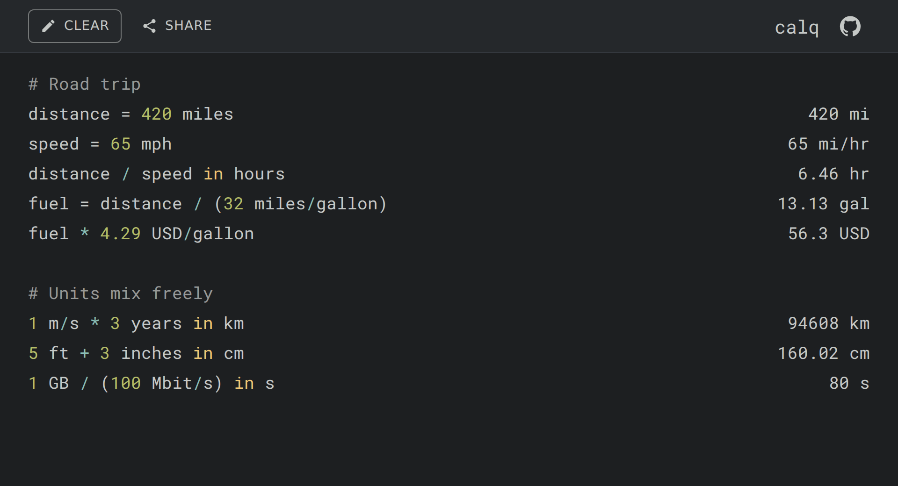

<h1 align="center">calq</h1>

<p align="center">
  <strong>A calculator for humans.</strong><br />
  Write math the way you think about it, units included.
</p>

<p align="center">
  <a href="https://calq.app"><strong>calq.app</strong></a> ·
  <a href="https://github.com/advait/calq/actions/workflows/node.js.yml"></a>
</p>

<p align="center">
  
</p>

## What it does

calq is a notepad that evaluates every line as you type, with each answer beside its line.

- **Units everywhere.** `1 m/s * 3 years in km` → `94608 km`. Length, time, mass, area, volume,
  speed, data (`1 GB / (100 Mbit/s)` → `80 s`), current, temperature (Kelvin), currency and
  more, with SI and binary prefixes.
- **Variables.** `distance = 420 miles`, then reuse `distance` on later lines.
- **Conversions.** End any expression with `in <unit>`.
- **Comments.** Lines starting with `#` are notes.
- **Copy.** Click an answer to copy it.
- **Share.** The Share button copies a link with your whole document in the URL. Your work is also
  saved in the browser between visits.

Every unit calq knows is defined in calq's own language, in
[`engine/src/Definitions.calq`](engine/src/Definitions.calq).

## Development

calq is a PureScript engine (`engine/`) behind a small React frontend (`frontend/`) with no UI
library, built with Vite.

Requirements: Node (version in [`.node-version`](.node-version)) and pnpm (version in
`packageManager` in [`package.json`](package.json)).

```sh
pnpm install
pnpm build:spago   # compile the engine to output/
pnpm dev           # http://localhost:8080
```

| Command          | What it does                                                  |
| ---------------- | ------------------------------------------------------------- |
| `pnpm dev`       | Vite dev server on port 8080 (run `pnpm dev:spago` alongside) |
| `pnpm test`      | Build the engine and run its spec and QuickCheck suites       |
| `pnpm test:e2e`  | Browser tests against `dist/` in desktop and mobile Chromium  |
| `pnpm typecheck` | Type-check the frontend and the browser tests                 |
| `pnpm lint`      | Format PureScript (purs-tidy) and TS (ESLint, Prettier)       |
| `pnpm run ci`    | Everything above, the same command CI runs                    |

Browser for the e2e tests: `pnpm exec playwright install chromium`.

Pushes to `master` that pass CI deploy to [calq.app](https://calq.app) via GitHub Pages.

The engine's concepts (axes, units, aliases) are described in [design.md](design.md).

## License

[MIT](LICENSE)
